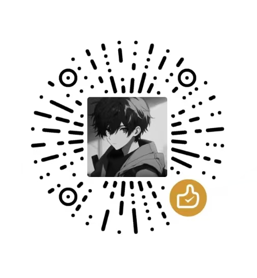

# 星空游戏学院 · StarLight Game Academy

> 星辰之源，创造起点

**在线预览：** https://ker0el.github.io/starlight-academy/

游戏设计、游戏美术、游戏开发 - 一个个人制作的的游戏学院官网。

## 特性

- **随机壁纸首屏**：背景由第三方图片接口随机返回二次元／游戏场景，每次打开都不一样
- **可读性处理**：图片上方叠加多层暗色渐变与氛围光，保证任意亮度的背景图下标题文字依然清晰
- **标题辉光**：主标题使用多层暖金辉光，并带 7 秒周期的呼吸动画（系统开启「减少动态」时自动停止）
- **滚动动效**：GSAP + ScrollTrigger 驱动的入场动画、首屏推镜视差与鼠标跟随
- **响应式**：桌面与移动端自适应布局

## 技术栈

- HTML5 / CSS3 / 原生 JavaScript
- [GSAP 3.12](https://gsap.com/) + ScrollTrigger（CDN 引入）

## 目录结构

```
.
├── index.html       页面结构
├── style.css        样式与动画
├── script.js        GSAP 动效与交互
├── assets/
│   └── zs.jpg       赞赏码
└── README.md
```

可以直接双击打开 `index.html`。

## 部署

站点部署在 **GitHub Pages**（`main` 分支根目录）。推送到 `main` 后会自动重新构建：

```bash
git push github main
```

> `style.css` 引用带有 `?v=` 版本号，修改样式后可同步递增，避免浏览器缓存旧文件。

## 赞赏

如果对你有帮助，欢迎请我喝杯咖啡 ☕



## 说明

- 背景图片由第三方随机接口提供，版权归原作者所有，本项目仅用于页面展示。
- 本项目用于学习与交流。
